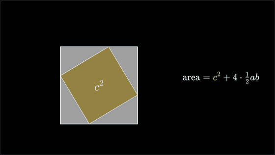
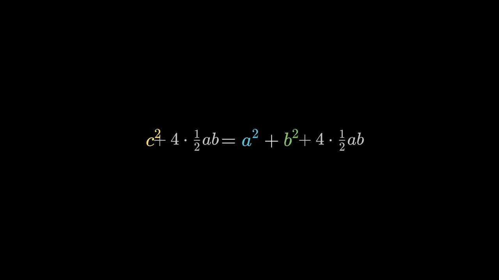
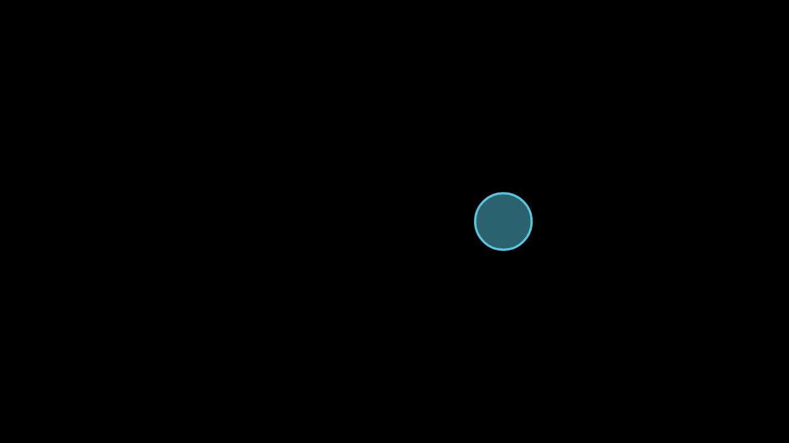

# Pymations

[](https://pypi.org/project/pymations/) [](https://www.npmjs.com/package/pymations) [](https://pypi.org/project/pymations/) [](LICENSE)

[](https://johnwylie70.github.io/pymations/)

**[See them playing in your browser, with their code →](https://johnwylie70.github.io/pymations/)** Nothing to install. Or **[change the code and run it on the Pymations page →](https://www.circuitry.dev/pymations)**

Pymations ("Python animations") makes maths animations in Python: shapes, equations, graphs and text that draw themselves, move, and turn into each other. Write a short Python program and it plays in your web browser, with a scrubber to pause, replay and drag to any moment. Run a scene with your own Python while you write it, then build it into a page that plays in any browser, on any website.

## Runs Manim Community scripts

Pymations runs scripts written for [Manim Community](https://www.manim.community) (Manim CE). `from manim import *` works, and so do `Scene` classes with a `construct()` method, so a script from a Manim tutorial, or one an AI assistant wrote, runs as it is.

Pymations is an independent project, not affiliated with Manim. It is its own implementation of Manim's script API, not a fork: no Manim code is included. Its defaults, placement and timings were checked against values measured from real Manim. Most 2D scenes run unchanged; [Differences from Manim](docs/differences-from-manim.md) lists what does not.



That is [`examples/pythagoras.py`](examples/pythagoras.py), a Manim script, running as it is.

## Install

```bash
pip install pymations
```

Python 3.9 or newer. Nothing else is installed: no LaTeX, no ffmpeg, no Cairo. Equations are drawn with KaTeX, in the browser.

## A first scene

Save this as `hello.py`:

```python
from pymations import *

square = Square(color=YELLOW)
circle = Circle(color=BLUE, fill_opacity=0.5)

play(Create(square))
play(Transform(square, circle))
play(square.animate.shift(RIGHT * 2).scale(0.5))
wait()
```



That is a whole program. `play()` adds animations to the scene's timeline, one after another, and `wait()` holds still for a second.

## The class form

The same scene, written the way Manim tutorials write it:

```python
from manim import *

class Hello(Scene):
    def construct(self):
        square = Square(color=YELLOW)
        circle = Circle(color=BLUE, fill_opacity=0.5)
        self.play(Create(square))
        self.play(Transform(square, circle))
        self.play(square.animate.shift(RIGHT * 2).scale(0.5))
        self.wait()
```

Every `Scene` class in a file plays, in the order they are written, each starting empty. The scrubber has a tick where each one starts. Use the bare form for short demos, and the class form for scripts you also want to run with Manim.

## Run it

```bash
pymations run hello.py
```

Your browser opens and the scene plays. The program runs in your own Python, so numpy and anything else you have installed works. Save the file and it runs again. Errors are shown on the page with the line they happened on.

Options: `--port 9000`, `--no-browser`.

## Share it

```bash
pymations build hello.py -o site/
```

`site/` is a folder of plain files that plays the scene entirely in the browser, with [Pyodide](https://pyodide.org) loaded from its official CDN. Put it on any static host. Every path in it is relative.

Or make one file:

```bash
pymations build hello.py -o hello.html
```

`hello.html` holds the scene and everything it needs, the animation engine and its fonts included, so you can email it, put it on any website, or open it straight from your disk. Python still loads from Pyodide's CDN.

## Use it on your website

```html
<div data-pymations-src="hello.py"></div>
<script type="module" src="pymations/pymations.js"></script>
```

Each animation fills its box, starts when it scrolls into view, and pauses when it is out of view. `pymations build my-page/ -o site/` copies your page and adds the `pymations/` folder. See [Building pages](docs/building-pages.md).

## What is supported

- **Shapes:** circles, squares, polygons, lines, arrows, arcs, angles, braces, dashed and curved lines, SVG files and pictures.
- **Text and maths:** `Text`, `MathTex` and `Tex` (drawn with KaTeX), `DecimalNumber`, tables, matrices and code.
- **Graphs:** `Axes`, `NumberPlane`, `NumberLine`, plots, areas and Riemann rectangles, bar charts, polar and complex planes, network graphs.
- **Animations:** `Create`, `Write`, `FadeIn`, `Transform`, `TransformMatchingTex`, `.animate`, `Indicate`, `LaggedStart`, and the rest of Manim's common set, with Manim's rate functions.
- **Updaters:** `ValueTracker`, `add_updater`, `always_redraw` and `TracedPath`. Most run in the browser, so scrubbing stays exact.
- **The camera:** `MovingCameraScene` and `self.camera.frame` to zoom and pan.
- **Pyctures drawing:** a scene can paint a background with [Pyctures](https://github.com/johnwylie70/pyctures)' `ctx` every frame, or place a Pyctures canvas inside the scene as an object.

3D scenes play flat, in 2D, and there is no video export or sound yet. [Differences from Manim](docs/differences-from-manim.md) has the full list.

## Examples

In [`examples/`](examples). The twelve reference scenes are real Manim Community scripts, unchanged. All of them play in the [online gallery](https://johnwylie70.github.io/pymations/).

| File | What it is |
|---|---|
| `pythagoras.py` | The theorem shown by rearranging four right triangles |
| `derivative.py` | A secant line closing in on the tangent |
| `unit_circle_sine.py` | A point going round the circle draws the sine wave |
| `completing_the_square.py`, `euler_identity.py`, `sum_pairing.py` | Algebra explained step by step |
| `tangent_slider.py`, `riemann_sum.py`, `cycloid.py` | Updaters: a sliding tangent, Riemann sums, a rolling wheel |
| `matrix_transform.py` | The plane moved by a matrix |
| `sin_cos_plot.py`, `grid_camera.py`, `moving_frame_box.py`, `brace_annotation.py`, `point_on_shapes.py`, `moving_around.py` | Graphs, the camera, braces and placement |
| `hello.py`, `hello_class.py` | The first scene, in both forms |
| `equation_steps.py`, `two_scenes.py`, `with_pyctures.py` | Equations, several scenes in one file, a Pyctures background |

```bash
pymations run examples/pythagoras.py
pymations run examples            # a list of them all
```

## Docs

Start with [Getting started](docs/getting-started.md), then [scenes and sections](docs/scenes-and-sections.md), [shapes](docs/shapes.md), [text and maths](docs/text-and-maths.md), [graphs](docs/graphs.md), [animations](docs/animations.md), [updaters](docs/updaters.md), [layout](docs/layout.md), [colours](docs/colours.md) and [the camera](docs/camera.md). [Building pages](docs/building-pages.md) covers sharing, and [Differences from Manim](docs/differences-from-manim.md) what runs differently. Tutorials are in [docs/tutorials](docs/tutorials).

## Pymations in Circuitry Studio

Pymations comes from [Circuitry Studio](https://www.circuitry.dev), where Python scenes play in a code editor with a live preview beside the code. It runs on phones, iPad, the web and desktop, and no subscription is needed to use it. Scenes written with this library run there unchanged, and the other way round.

Its Pymations page, where you can edit a scene and play it: [circuitry.dev/pymations](https://www.circuitry.dev/pymations).

## Licence

MIT. See [LICENSE](LICENSE). Pymations includes KaTeX (MIT), opentype.js (MIT) and the Liberation Sans font (SIL OFL 1.1), and loads Pyodide (MPL 2.0) from its CDN; see [THIRD-PARTY-NOTICES](THIRD-PARTY-NOTICES).

Author: John Wylie
