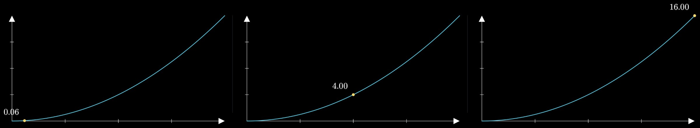

# Pymations

[](https://pypi.org/project/pymations/) [](https://www.npmjs.com/package/pymations) [](https://pypi.org/project/pymations/) [](LICENSE)

[](https://johnwylie70.github.io/pymations/)

**[See them playing in your browser, with their code →](https://johnwylie70.github.io/pymations/)** Nothing to install. Or **[change the code and run it on the Pymations page →](https://www.circuitry.dev/pymations)**

Pymations ("Python animations") makes maths animations and explainers in Python: shapes, equations, graphs, pictures and text that draw themselves, move, and turn into each other. Write a short program and it plays straight away in your web browser, with a scrubber to pause, replay and drag to any moment. It runs scripts written for [Manim Community](https://www.manim.community) unchanged, and builds any scene into a web page that plays on any website.

- **Plays as you write.** Scenes play in real time in the browser; there is no render step to wait for.
- **Runs Manim scripts.** `from manim import *` and `Scene` classes work, so a script from a Manim tutorial, or one an AI assistant wrote, runs as it is.
- **Nothing heavy to install.** `pip install pymations` installs nothing else: no LaTeX, no ffmpeg, no Cairo. Equations are drawn with KaTeX.
- **Shares as one file.** `pymations build` makes a folder or a single `.html` file that plays anywhere.
- **Explainer helpers.** Titles, callouts, cards, a spotlight, scene transitions, pictures, voice-over and music.

## Install

```bash
pip install pymations
```

Python 3.9 or newer.

## A first scene

Save this as `hello.py`:

```python
from pymations import *

square = Square(color=YELLOW)
circle = Circle(color=BLUE, fill_opacity=0.5)

play(Create(square))
play(Transform(square, circle))
play(square.animate.shift(RIGHT * 2).scale(0.5))
wait()
```


That is a whole program. `play()` adds animations to the scene's timeline, one after another, and `wait()` holds still for a second.

## The class form

The same scene, written the way Manim tutorials write it:

```python
from manim import *

class Hello(Scene):
    def construct(self):
        square = Square(color=YELLOW)
        circle = Circle(color=BLUE, fill_opacity=0.5)
        self.play(Create(square))
        self.play(Transform(square, circle))
        self.play(square.animate.shift(RIGHT * 2).scale(0.5))
        self.wait()
```

Every `Scene` class in a file plays, in the order they are written, each starting empty. The scrubber has a tick where each one starts. Use the bare form for short demos, and the class form for scripts you also want to run with Manim.

## Things that follow each other

Updaters keep one thing tied to another while it moves. Here a dot rides the curve and its value goes with it:

```python
from pymations import *

x = ValueTracker(0)
axes = Axes(x_range=[0, 4, 1], y_range=[0, 16, 4])
curve = axes.plot(lambda t: t ** 2, color=BLUE)
dot = always_redraw(lambda: Dot(axes.c2p(x.get_value(), x.get_value() ** 2), color=YELLOW))
value = always_redraw(lambda: DecimalNumber(x.get_value() ** 2).next_to(dot, UP))

play(Create(axes), Create(curve))
add(dot, value)
play(x.animate.set_value(4), run_time=3)
wait()
```



They are worked out in the browser on every frame, so dragging the scrubber to any moment shows exactly what plays there. [Updaters](docs/updaters.md) has the rest.

## Manim Community scripts

Manim was created by Grant Sanderson to make the animations in his [3Blue1Brown](https://www.3blue1brown.com) maths videos. [Manim Community](https://www.manim.community) is the community-maintained version that most people use today. Pymations is a fresh rewrite of its script API, not a fork: no Manim code is included. It is built to play in real time in a browser, and its defaults, placement and timings were checked against values measured from real Manim. Most 2D scenes run unchanged; [Differences from Manim](docs/differences-from-manim.md) lists what does not.


That is [`examples/pythagoras.py`](examples/pythagoras.py), a Manim script, running as it is.

Pymations is an independent project and is not affiliated with Manim, Manim Community or 3Blue1Brown.

## Run it

```bash
pymations run hello.py
```

Your browser opens and the scene plays. The program runs in your own Python, so numpy and anything else you have installed works. Save the file and it runs again. Errors are shown on the page with the line they happened on.

Options: `--port 9000`, `--no-browser`.

## Share it

```bash
pymations build hello.py -o site/
```

`site/` is a folder of plain files that plays the scene entirely in the browser, with [Pyodide](https://pyodide.org) loaded from its official CDN. Put it on any static host. Every path in it is relative.

Or make one file:

```bash
pymations build hello.py -o hello.html
```

`hello.html` holds the scene and everything it needs, the animation engine and its fonts included, so you can email it, put it on any website, or open it straight from your disk. Python still loads from Pyodide's CDN.

## Use it on your website

```html
<div data-pymations-src="hello.py"></div>
<script type="module" src="pymations/pymations.js"></script>
```

Each animation fills its box, starts when it scrolls into view, and pauses when it is out of view. `pymations build my-page/ -o site/` copies your page and adds the `pymations/` folder. See [Building pages](docs/building-pages.md).

## What is supported

- **Shapes:** circles, squares, polygons, lines, arrows, arcs, angles, braces, dashed and curved lines, SVG files and pictures, and Boolean shapes (union, intersection, difference, exclusion).
- **Text and maths:** `Text`, `MathTex` and `Tex` (drawn with KaTeX), `DecimalNumber`, tables, matrices and code.
- **Graphs:** `Axes`, `NumberPlane`, `NumberLine`, plots, areas and Riemann rectangles, bar charts, polar and complex planes, network graphs.
- **Animations:** `Create`, `Write`, `FadeIn`, `Transform`, `TransformMatchingTex`, `.animate`, `Indicate`, `LaggedStart`, and the rest of Manim's common set, with Manim's rate functions.
- **Updaters:** `ValueTracker`, `add_updater`, `always_redraw` and `TracedPath`. Most run in the browser, so scrubbing stays exact.
- **The camera:** `MovingCameraScene` and `self.camera.frame` to zoom and pan.
- **Explainers:** `Card`, `Callout`, `LowerThird`, `Badge`, `Highlight`, `Spotlight`, `EndCard`, pictures with rounded corners and shadows, and transitions between scenes.
- **Sound:** voice-overs, music and sound effects, in step with the scrubber.
- **Pyctures drawing:** a scene can paint a background with [Pyctures](https://github.com/johnwylie70/pyctures)' `ctx` every frame, or place a Pyctures canvas inside the scene as an object.

3D scenes play flat, in 2D. [Differences from Manim](docs/differences-from-manim.md) has the full list.

## Make a video

The library plays scenes and builds pages; it does not write video files yet. To make a video, open the scene in [Circuitry](https://www.circuitry.dev/pymations): its code editor has a live preview beside the code and a **Record Video** button that renders the scene frame by frame to MP4 (720p, 1080p, 4K, Shorts or square, 30 or 60 fps) with nothing dropped and sound in step. There you can also mix scenes with [Pyctures](https://github.com/johnwylie70/pyctures) 2D and 3D animations, and prepare pictures in code (cut out a product, resize, trace a logo into shapes).

## Examples

In [`examples/`](examples). The twelve reference scenes are real Manim Community scripts, unchanged. All of them play in the [online gallery](https://johnwylie70.github.io/pymations/).

| File | What it is |
|---|---|
| `pythagoras.py` | The theorem shown by rearranging four right triangles |
| `derivative.py` | A secant line closing in on the tangent |
| `unit_circle_sine.py` | A point going round the circle draws the sine wave |
| `completing_the_square.py`, `euler_identity.py`, `sum_pairing.py` | Algebra explained step by step |
| `tangent_slider.py`, `riemann_sum.py`, `cycloid.py` | Updaters: a sliding tangent, Riemann sums, a rolling wheel |
| `matrix_transform.py` | The plane moved by a matrix |
| `sin_cos_plot.py`, `grid_camera.py`, `moving_frame_box.py`, `brace_annotation.py`, `point_on_shapes.py`, `moving_around.py` | Graphs, the camera, braces and placement |
| `hello.py`, `hello_class.py` | The first scene, in both forms |
| `equation_steps.py`, `two_scenes.py`, `with_pyctures.py` | Equations, several scenes in one file, a Pyctures background |

```bash
pymations run examples/pythagoras.py
pymations run examples            # a list of them all
```

## Docs

Start with [Getting started](docs/getting-started.md), then [scenes and sections](docs/scenes-and-sections.md), [shapes](docs/shapes.md), [text and maths](docs/text-and-maths.md), [graphs](docs/graphs.md), [animations](docs/animations.md), [updaters](docs/updaters.md), [layout](docs/layout.md), [colours](docs/colours.md), [the camera](docs/camera.md), [sound](docs/sound.md) and [titles and callouts](docs/presentation.md). [Building pages](docs/building-pages.md) covers sharing, and [Differences from Manim](docs/differences-from-manim.md) what runs differently. Tutorials are in [docs/tutorials](docs/tutorials).

## Pymations in Circuitry Studio

Pymations comes from [Circuitry Studio](https://www.circuitry.dev), which runs on phones, iPad, the web and desktop. Scenes written with this library run there unchanged, and the other way round. Edit a scene and play it on its Pymations page: [circuitry.dev/pymations](https://www.circuitry.dev/pymations).

## Licence

MIT. See [LICENSE](LICENSE). Pymations includes KaTeX (MIT) with its fonts (SIL OFL 1.1), opentype.js (MIT) and the Liberation Sans font (SIL OFL 1.1), and loads Pyodide (MPL 2.0) from its CDN; see [THIRD-PARTY-NOTICES](THIRD-PARTY-NOTICES).

Author: John Wylie
